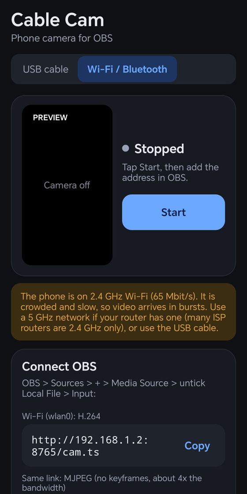
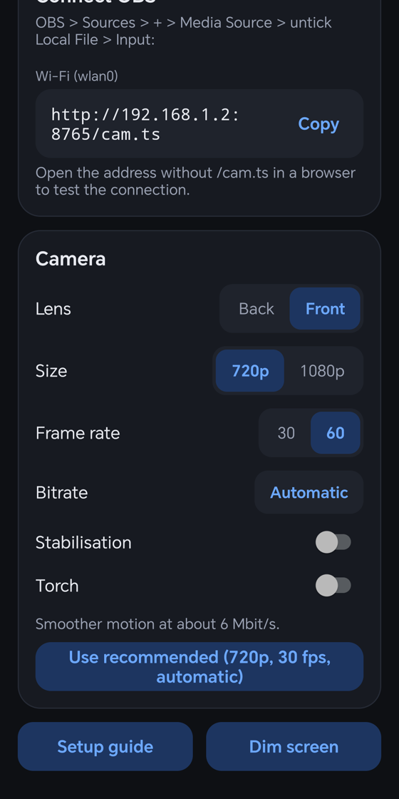

# Cable Cam

[](https://github.com/Kariiem/cable-cam/actions/workflows/ci.yml)
[](COPYING)

**Use your Android phone as a camera source in OBS. No watermark, nothing to install on the PC except OBS.**

Cable Cam turns the phone into a tiny web server that streams its camera. OBS's built-in **Media Source** opens the address, and OBS's own **Virtual Camera** passes the picture on to Teams, Zoom, Google Meet and any other app that wants a webcam. No PC driver, no plugin, no admin rights on the PC side, no firewall prompt: OBS only makes an outgoing connection.

<p align="center">
  
  &nbsp;&nbsp;
  
</p>

## Contents

- [Features](#features)
- [Status: what has been tested](#status-what-has-been-tested)
- [How it works](#how-it-works)
- [Quick start](#quick-start)
- [Connecting phone and PC](#connecting-phone-and-pc)
- [Two formats: the URL decides](#two-formats-the-url-decides)
- [OBS settings](#obs-settings)
- [Virtual Camera for meetings](#virtual-camera-for-meetings)
- [Settings and recommendations](#settings-and-recommendations)
- [Getting the lowest delay](#getting-the-lowest-delay)
- [Troubleshooting](#troubleshooting)
- [Privacy and security](#privacy-and-security)
- [Limitations](#limitations)
- [Development](#development)
- [License](#license)

## Features

- **Two ways to connect:** USB cable (USB tethering) or wireless (Wi-Fi, the phone's hotspot, Bluetooth tethering). The phone shows the right address for each link that exists.
- **Two stream formats, chosen by the URL you type in OBS:** `/cam.ts` is H.264 (light on bandwidth, sharp), `/cam.mjpg` is Motion JPEG (no keyframes, recovers from a stall instantly). Neither is the default.
- **Portrait output** (720x1280 or 1080x1920), like the phone held upright. Each frame is rotated on the GPU, so front and back camera are both upright.
- **No audio, no account, no internet.** The only runtime permission is the camera.
- **Encodes only while someone is watching.** The camera preview stays on, but the encoder starts when OBS connects and stops shortly after it leaves.
- **Built to be left alone for a long call:** a foreground service, a low-latency Wi-Fi lock, thermal back-off (lower bitrate when the phone gets hot), an optional dimmed screen to save power.
- **Honest diagnostics in the app:** a status pill, the live bitrate, the phone's own delay, and banners that say *why* a stream is bad (VPN active, 2.4 GHz Wi-Fi, dropped frames, hot phone).
- **Small and dependency-free:** Kotlin, plain Android Views, Camera2, MediaCodec and OpenGL ES. No third-party libraries, no Compose, no CameraX.

## Status: what has been tested

Cable Cam was written for and tested on **one phone**: an HONOR X9c (MagicOS 9, Android 15), with OBS Studio 33 on Windows.

| Verified on real hardware | Not verified |
| --- | --- |
| USB tethering and Wi-Fi, each with the Media Source in OBS, both formats | Bluetooth tethering |
| Portrait orientation, front and back camera | OBS Virtual Camera feeding a meeting app, end to end |
| Stream decoded by ffmpeg/ffprobe, timing measured with the scripts in `scripts/` | Other phones, macOS or Linux OBS (should work, never tried) |

Other Android 10+ phones should work (`minSdk` 29), but encoder and tethering behaviour varies by vendor. Reports are welcome.

## How it works

```
Phone (Android app)                                                  PC
 Camera2 ──┬─> preview on screen
           └─> GPU pass (rotate to portrait) ──┬─> H.264 encoder ─> MPEG-TS ─┐
                                               └─> JPEG per frame ───────────┤
                                                                             v
                                                   HTTP server on port 8765  <──  OBS Media Source
                                                   /cam.ts   /cam.mjpg   /        (outgoing connection only)
                                                                                    │
                                                              OBS Virtual Camera ───┘──> Teams / Zoom / Meet
```

- **The phone is the server and OBS is the client.** OBS only connects out, so Windows shows no firewall prompt and no admin rights are needed.
- Every link is an ordinary IP link. USB tethering, Wi-Fi, the phone's hotspot and Bluetooth tethering only differ in how the network between phone and PC comes to exist.
- `GET /` shows a small status page, so "can the PC reach the phone?" is a one-second check in a browser.

## Quick start

1. **Install the app.** Download `app-release.apk` from the repository's Releases page when one is published, or build it yourself (see [Development](#development)). Android asks you to allow installing from your browser or file manager.
2. **Open Cable Cam** and allow the camera (and notifications, so you can stop the stream from the notification).
3. **Choose a mode** at the top: *USB cable*, or *Wi-Fi / Bluetooth*. See [Connecting phone and PC](#connecting-phone-and-pc).
4. **Tap Start.** The Connect card lists an address for each link, for example `http://192.168.42.129:8765/cam.ts`.
5. **In OBS:** Sources, **+**, **Media Source**, untick **Local File**, and paste the address as **Input**. Then apply the [OBS settings](#obs-settings) below (they matter a lot for delay).
6. For a meeting app, start OBS's **Virtual Camera** ([details](#virtual-camera-for-meetings)).

## Connecting phone and PC

| Mode | What you do | Notes |
| --- | --- | --- |
| **USB cable** | Plug the phone into the PC and turn on **USB tethering**. | Best picture and lowest delay: no radio in between. Windows 10/11 sets up the network adapter by itself. The app has a button that opens your phone's mobile network settings. |
| **Wi-Fi** | Phone and PC on the same network. | Fine on 5 GHz. On a busy 2.4 GHz network the video arrives in bursts (see [below](#getting-the-lowest-delay)). |
| **Phone hotspot** | Connect the PC to the phone's hotspot. | Phone to PC in one hop, but the PC uses the phone's mobile data for everything else. |
| **Bluetooth tethering** | Pair, turn on Bluetooth tethering, join the personal network on the PC. | **Not verified.** Bandwidth is about 1 to 2 Mbit/s, so the app lowers the bitrate to 1.2 Mbit/s and the picture is soft. |

Tethering lives in different places on different phones. On the HONOR: *Settings, Mobile network, Personal hotspot, USB tethering*.

USB tethering can stay on while the phone is on Wi-Fi; the app shows an address for every link it finds.

**No tethering available?** If you have `adb` on the PC and USB debugging on the phone, `adb forward tcp:8765 tcp:8765` makes the phone reachable as `http://127.0.0.1:8765/cam.ts` (or `/cam.mjpg`). The app does not need adb for anything else.

## Two formats: the URL decides

The ending of the address you give OBS selects the encoding. The app never chooses for you, and both can run at the same time.

| | `/cam.ts` (H.264 in MPEG-TS) | `/cam.mjpg` (Motion JPEG) |
| --- | --- | --- |
| Bandwidth at 720p30 | about 4 Mbit/s | about 9 Mbit/s |
| Picture detail | better (inter-frame compression) | less fine detail for the same effort |
| Fast motion, then stop | can lag: OBS may sit on buffered frames | shows the newest picture, catches up at once |
| Stalls on the link | a stall delays everything behind it; keyframes (about 100 KB) make bursts | a slow client skips straight to the newest picture |
| OBS start-up | needs a small probe size, else about 6 s | first picture in about 0.2 s |
| Good for | meetings on a reasonable link, Bluetooth, anything with limited bandwidth | USB, or a link with room to spare, when responsiveness matters |

Measured with the probe scripts in `scripts/` (720p30, 20 s each, one phone and one PC; your numbers will differ):

| Link | Format | Result |
| --- | --- | --- |
| Wi-Fi 2.4 GHz | H.264 | arrival jitter p95 345 ms, 12 stalls over 100 ms, longest 1062 ms |
| Wi-Fi 2.4 GHz | MJPEG | 29.4 fps, gaps p95 66 ms, max 103 ms, 1 stall over 100 ms |
| USB tethering | H.264 | arrival jitter p95 9 ms, max 14 ms |
| USB tethering | MJPEG | 30.0 fps, gaps p95 36 ms, max 55 ms, no stall |

Time to the first picture in ffmpeg (the decoder behind OBS's Media Source): H.264 with only `fflags=nobuffer flags=low_delay` took 6.2 s, with `probesize=32768` added 2.2 s; MJPEG took 0.16 s.

MJPEG quality is fixed at 75 for now (about 38 KB per 720p picture).

## OBS settings

Add a **Media Source** (untick *Local File*), then:

| Setting | Value | Why |
| --- | --- | --- |
| **Input** | `http://<phone-ip>:8765/cam.ts` or `.../cam.mjpg` | the ending picks the format |
| **Input Format** | empty | OBS detects it |
| **Network Buffering** | **0 MB** | OBS's default of 2 MB holds about 2 seconds of video at 4 Mbit/s |
| **Reconnect Delay** | 1 s | OBS reconnects when you restart the stream |
| **Use hardware decoding** | on | |
| **Restart playback when source becomes active** | off | |
| **FFmpeg Options** for `/cam.ts` | `probesize=32768 fflags=nobuffer flags=low_delay` | without `probesize`, FFmpeg reads 5 MB (about 5 seconds) before showing anything, and that stays as lag |
| **FFmpeg Options** for `/cam.mjpg` | `fflags=nobuffer flags=low_delay` | nothing to probe: every picture stands alone |

After changing options, switch the source off and on.

**Portrait video in a landscape canvas.** The stream is portrait. In OBS, either scale and crop the source to fill a landscape canvas, or set **Settings, Video, Base (Canvas) Resolution** to `720x1280` (the box accepts typed values) if you want a portrait output.

## Virtual Camera for meetings

1. In OBS click **Start Virtual Camera** (Controls panel).
2. In Teams, Zoom or Meet, choose **OBS Virtual Camera** as the camera.
3. The meeting app uses the PC's microphone as before; Cable Cam sends no audio.

If the **Start Virtual Camera** button is missing, the virtual camera driver is not registered. The normal OBS installer does that for you. Portable and package-manager installs (for example `scoop`) leave it to you: run `virtualcam-install.bat` from OBS's `core\win-dshow\data` folder **as administrator, once**. This is OBS's own one-time step, and it needs admin rights. On a managed PC your IT team may block or flag it: ask them rather than working around it. Without a virtual camera you can still use OBS's *Windowed Projector* and share that window in a meeting.

## Settings and recommendations

The Camera card has: lens (back or front), size (720p or 1080p), frame rate (30 or 60), bitrate (automatic or fixed), stabilisation and torch. Every combination is allowed; the app prints one line about what your choice costs, and a button returns to the recommended setting.

| Setting | Bitrate (automatic) | When |
| --- | --- | --- |
| **720p, 30 fps** | about **4 Mbit/s** | **Recommended** for meetings. Smooth and light. |
| 720p, 60 fps | about 6 Mbit/s | smoother motion |
| 1080p, 30 fps | about 8 Mbit/s | sharper picture, on a good link |
| 1080p, 60 fps | about 12 Mbit/s | heavy: USB cable and a PC that decodes in hardware. On 2.4 GHz Wi-Fi it ran at about 7 fps. |
| any, over Bluetooth | 1.2 Mbit/s | the link cannot carry more |

If the camera does not offer 60 fps at a size, it runs at the fastest rate it has. Automatic bitrate follows the slowest connected link and drops to 60% or 40% when the phone reports it is hot.

**Dim screen** blacks the display while the stream keeps running (tap to wake). The screen stays on while streaming; that and a foreground notification keep the phone from stopping the camera.

## Getting the lowest delay

Work through this in order; most of the lag people see is the receiving side or the radio, not the phone (the phone itself adds about 80 to 100 ms from camera to encoded frame, shown in the app as "phone delay").

1. **OBS:** Network Buffering 0 MB and the FFmpeg options from the table above. Then switch the source off and on.
2. **Use the USB cable** if you can. Over Wi-Fi each frame crosses the radio twice (phone to router, router to PC).
3. **Check the Wi-Fi band.** The app warns when the phone is on 2.4 GHz, which is crowded, half-duplex and slow. Use a 5 GHz network on both devices if your router has one. Many ISP routers are 2.4 GHz only, and then there is no setting to switch.
4. **Pick the format for the link:** MJPEG when you have bandwidth and want instant response, H.264 when bandwidth is tight.
5. **Use 720p, 30 fps.**
6. **Pause any VPN or DNS blocker on the phone** (see below).

## Troubleshooting

| Symptom | Cause and fix |
| --- | --- |
| OBS shows nothing and the log says the connection timed out | A **VPN on the phone** (including DNS and ad blockers such as RethinkDNS) blocks connections coming in from the PC. Pause it while streaming. The app warns when a VPN is active. |
| The browser cannot open `http://127.0.0.1:8765/cam.ts` | That address only works on a PC where `adb forward` is running. Use the address the app shows for your link. A browser also cannot play `.ts`; open the address *without* `/cam.ts` to see the status page. |
| No USB address appears | Is USB tethering on, with the cable plugged in? Wait a few seconds. If it still does not show, try turning the phone's Wi-Fi off (not checked on every phone). |
| The picture is delayed by seconds | See [Getting the lowest delay](#getting-the-lowest-delay). Network Buffering and `probesize` are the usual cause for `/cam.ts`. |
| The picture stutters, the app says "Dropping frames" | The link is too slow for the bitrate. Lower the size or bitrate, use USB, or choose a better Wi-Fi band. |
| **Start Virtual Camera** is missing in OBS | The virtual camera is not registered. See [Virtual Camera for meetings](#virtual-camera-for-meetings). |
| The stream stops when the screen turns off | Exempt Cable Cam from battery optimisation in the phone's settings, and use *Dim screen* rather than locking the phone. |
| The camera is busy | Another app is using it. Close it and tap Start again. |
| "Cannot listen on port 8765" | Another process holds the port. Stop it, or restart the phone. |

## Privacy and security

- **No internet access is used.** The app opens no outgoing connection and has no analytics. The `INTERNET` permission is declared only because Android requires it to run a local server.
- **Permissions:** `CAMERA` (asked at runtime), `POST_NOTIFICATIONS`, `FOREGROUND_SERVICE` and `FOREGROUND_SERVICE_CAMERA` (the camera service), `ACCESS_WIFI_STATE` (reads the Wi-Fi band and speed for the slow-link warning), `ACCESS_NETWORK_STATE`, `WAKE_LOCK` (keeps the CPU and a low-latency Wi-Fi lock while streaming). No microphone, storage, location or contacts.
- **The server only answers private-network and loopback addresses** (10.x, 172.16-31.x, 192.168.x, 169.254.x, 127.x). A connection arriving over the mobile-data interface from the public internet is refused.
- **There is no password and no encryption.** Anyone on the same network can open the stream while it is running. Use it on networks you trust (your home, the phone's own hotspot, a cable), not on a shared Wi-Fi at a cafe or hotel.
- The stream runs only while you have pressed Start; the Stop button, or the Stop action in the notification, ends it.

## Limitations

- Portrait output only. Rotate or crop the source in OBS for a landscape picture.
- No audio (OBS's Virtual Camera has none either; meeting apps use the PC's microphone).
- MJPEG quality is not adjustable yet, and MJPEG at 1080p60 needs a very fast link.
- No authentication or encryption (see above).
- Tested on one phone; Bluetooth tethering and the virtual-camera path into meeting apps are unverified.

---

## Development

### Prerequisites

| Tool | Version used | Notes |
| --- | --- | --- |
| **JDK** | 21 (Eclipse Temurin) | runs Gradle and the Android build; the code compiles to JVM 17 bytecode |
| **Android SDK** | platform `android-35`, build-tools `35.0.0`, command-line tools, platform-tools (`adb`) | `compileSdk` and `targetSdk` are 35, `minSdk` is 29 |
| **Gradle** | 9.3.1 | the wrapper (`./gradlew`) downloads it (about 130 MB); a system install of the same version works too |
| **Android Gradle Plugin / Kotlin** | 8.13.0 / 2.2.20 | pinned in `build.gradle.kts`; JUnit 4.13.2 is the only dependency (tests) |
| **An Android phone** | Android 10+ | USB debugging or Wireless debugging. Real hardware is needed for anything touching the camera or encoder. |
| `ffmpeg` and `ffprobe` | any recent | optional: used by `FfmpegCompatTest` (skipped when absent) and for manual checks |
| `python3` | 3.8+ | optional: the probe scripts in `scripts/` |
| A signing keystore | | optional: only for `scripts/build-release.sh` |

### Setup

```bash
git clone <this repository> cable-cam && cd cable-cam

# tell Gradle where the Android SDK is (this file is git-ignored)
echo "sdk.dir=/path/to/android-sdk" > local.properties

# the SDK pieces, if you do not have them yet
sdkmanager "platforms;android-35" "build-tools;35.0.0" "platform-tools"

# make sure a JDK 21 is the one Gradle sees
export JAVA_HOME=/path/to/jdk-21
export PATH="$JAVA_HOME/bin:$PATH"
```

### Build and test

```bash
gradle :app:assembleDebug        # app/build/outputs/apk/debug/app-debug.apk   (use ./gradlew if you have no system Gradle)
gradle :app:testDebugUnitTest    # JVM unit tests
gradle :app:lintDebug            # lint: errors fail the build
```

The tests cover the parts that need no phone: the MPEG-TS muxer (packet structure, CRCs, PTS/PCR, continuity counters), the HTTP server over real sockets (both formats, the slow-client policies), address and link classification, presets and settings. `FfmpegCompatTest` additionally feeds real H.264 through the muxer and has ffmpeg decode it, so a stream that "looks right" but breaks a real player is caught.

### Run on a phone

Wireless debugging works without a cable (Developer options, *Wireless debugging*). The pairing port, the pairing code and the connection port are three different things, and the ports change whenever the feature is toggled:

```bash
adb pair <phone-ip>:<pairing-port> <code>      # once; the port is on the "Pair device with pairing code" dialog
adb mdns services                              # lists the live connect port
adb connect <phone-ip>:<connect-port>
adb -s <phone-ip>:<connect-port> install -r app/build/outputs/apk/debug/app-debug.apk
adb shell pm grant com.cablecam android.permission.CAMERA
adb shell pm grant com.cablecam android.permission.POST_NOTIFICATIONS   # a permission dialog on screen breaks adb-driven runs
adb shell am start -n com.cablecam/.ui.MainActivity
```

Useful: `adb exec-out screencap -p > shot.png`, `adb shell uiautomator dump /sdcard/ui.xml` (labels and bounds, so you can `input tap` a button; it can fail while the camera preview is running). The stream service is not exported, so only the app's own Stop button stops it, not `adb shell am`.

### Check the stream without OBS

```bash
# is it a valid stream?
ffprobe -v error -show_streams http://<phone-ip>:8765/cam.ts
ffprobe -v error -show_streams http://<phone-ip>:8765/cam.mjpg

# how smoothly does it arrive? (frame arrival vs frame timestamp, stalls, bandwidth)
python3 scripts/probe_h264.py  <phone-ip> 20
python3 scripts/probe_mjpeg.py <phone-ip> 20

# one frame, to look at orientation and quality
ffmpeg -i http://<phone-ip>:8765/cam.ts -frames:v 1 frame.png
```

A **time to first picture** check shows receiver start-up cost, which is what hides in OBS as lag: `time ffmpeg -fflags nobuffer -flags low_delay -probesize 32768 -i http://<phone-ip>:8765/cam.ts -frames:v 1 -f null -`.

### Project layout

```
app/src/main/java/com/cablecam/
  ui/        MainActivity (screen), Ui.kt (cards, buttons, segmented control), Guide.kt (in-app help text),
             CrashReport.kt (shows the last crash on the next start, no adb needed)
  service/   StreamService      foreground service (type camera): owns the camera, the encoders and the server
  camera/    CameraController   Camera2 session with up to three outputs: preview, H.264 path, JPEG path
             FrameRotator       EGL/OpenGL pass: camera frames -> upright portrait frames in any Surface
  stream/    VideoEncoder       MediaCodec H.264 (hardware, CBR, no B-frames, 2 s keyframes)
             MjpegEncoder       ImageReader -> JPEG per picture
             TsMuxer            pure Kotlin MPEG-TS muxer (PAT, PMT, PES, PCR)  <- no Android classes
             StreamServer       HTTP server, per-client queues and policies     <- no Android classes
             Access             who may connect (private networks and loopback)
  net/       Links              classifies interfaces (USB, Wi-Fi, hotspot, Bluetooth), VPN and Wi-Fi advice
  settings/  Settings (SharedPreferences), Presets (sizes, bitrates, advice text)
app/src/test/java/...           JVM tests, mirroring the packages above
scripts/                        build-release.sh, probe_h264.py, probe_mjpeg.py
PLAN.md                         design decisions, measurement log, risks
```

### How a frame travels

1. `CameraController` runs one capture session. Its outputs are the preview `SurfaceView` plus, only while an OBS client of that kind is connected, a `FrameRotator` input per format.
2. `FrameRotator` is an EGL pass that draws the camera texture into the target Surface. The `SurfaceTexture` transform matrix already contains the sensor rotation, so the image comes out upright for front and back cameras with no extra code.
3. For H.264 the target is the `MediaCodec` input surface; encoded access units go to `StreamServer.broadcast`, which gives each client its own `TsMuxer`, writer thread and bounded queue. For MJPEG the target is an `ImageReader`; each picture is compressed to a JPEG and offered to `broadcastJpeg`, where each client holds only the newest one.
4. `StreamService` starts and stops the encoders as clients come and go, adjusts the bitrate to the slowest link and to the phone's temperature, and publishes a status the activity renders.

### Conventions

- Kotlin, plain Views built in code. **No Compose, no CameraX, no third-party libraries.**
- Keep `TsMuxer` and `StreamServer` free of Android classes so they stay testable on the JVM.
- The phone is the server and OBS the client: never require an inbound port or a firewall rule on the PC.
- Minimal permissions: the camera is the only runtime permission. No audio unless it is a deliberate, documented feature.
- Targeting SDK 35 means edge-to-edge is forced: apply the system-bar insets to the root view.
- A change to a URL, the port or a stream format updates `README.md`, `PLAN.md` and `ui/Guide.kt` together.
- Commit in small functional blocks. After every commit the app builds and the tests pass.

### Notes from developing on MagicOS (HONOR X9c)

- The app's own `Log` output does not show up in `logcat` on this phone, so diagnostics worth having are shown in the UI (for example "phone delay").
- Direct links to the tethering screens (`TETHER_SETTINGS`, the settings activities) start and close at once. `ACTION_NETWORK_OPERATOR_SETTINGS` opens the *Mobile network* page, which lists *Personal hotspot*.
- A foreground service of type `camera` needs the CAMERA permission granted before `startForeground`, and must be started from a visible activity.
- Camera timestamps use the monotonic clock (`System.nanoTime()`), not `elapsedRealtime`.
- Android requires `launchMode="singleTop"` for `onNewIntent` to reach an open activity.

### Releasing

`scripts/build-release.sh` runs the tests and lint and builds a signed APK into `dist/` with a checksum. It needs a git-ignored `keystore.properties`:

```
storeFile=/path/to/keystore.jks
storePassword=...
keyAlias=...
keyPassword=...
```

Keep the keystore outside the repository: every later release must be signed with the same key, or Android refuses to update the installed app. Releases are manual (`gh release create`); CI builds and tests but never signs or publishes.

### Ideas and open work

- Verify Bluetooth tethering and the Virtual Camera path into meeting apps on more setups.
- A JPEG quality setting; landscape output as an option; optional AAC audio in the MPEG-TS.
- Intra-refresh instead of periodic keyframes for H.264, to remove the 100 KB bursts (encoder support varies).
- Optional password for the stream.
- More devices: reports of what works (and what does not) on other phones are very welcome.

### Contributing

See [CONTRIBUTING.md](CONTRIBUTING.md). Open an issue before large changes; small fixes and device reports can go straight to a pull request.

## License

Dual-licensed: you may use Cable Cam under **either** the [MIT License](LICENSE-MIT) **or** the [Unlicense](UNLICENSE) (a public-domain dedication), at your option. See [COPYING](COPYING).

`SPDX-License-Identifier: MIT OR Unlicense`
